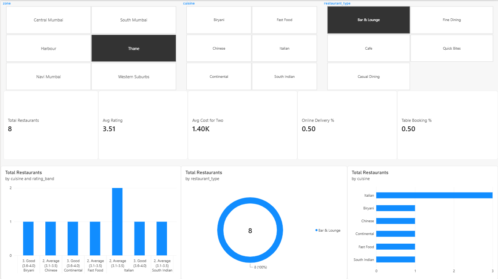

# Restaurant Insights: Rating, Pricing & Locality Analysis Dashboard
An interactive **Power BI** dashboard that analyses how restaurant **ratings**, **pricing** and
**locality** relate to each other across Mumbai, built on a cleaned dataset prepared with Python.

**Data note:** the dataset in this repo is **synthetic sample data** generated by
`scripts/01_generate_data.py` to demonstrate the analysis workflow. It is not real Zomato/Swiggy data.

## Objectives
1. Clean and prepare restaurant data for analysis.
2. Analyse the relationship between **cost for two** and **rating**.
3. Compare **localities and zones** on rating, price and value for money.
4. Build an interactive dashboard with slicers for exploration.

## Tech Stack
- **Python** (pandas, numpy) - data generation and cleaning
- **Power BI Desktop** - data model, DAX measures, dashboard
- **GitHub** - version control and sharing

## Project Structure
```
restaurant-insights-dashboard/
|-- data/
|   |-- restaurants_raw.csv        # messy raw data
|   |-- restaurants_clean.csv      # cleaned data used in Power BI
|-- scripts/
|   |-- 01_generate_data.py        # creates sample dataset
|   |-- 02_clean_data.py           # cleaning + derived columns
|-- powerbi/
|   |-- dax_measures.md            # all DAX measures
|   |-- dashboard_build_guide.md   # page-by-page visual layout
|   |-- Restaurant_Insights.pbix   # the dashboard file (add after you build it)
|-- docs/
|   |-- screenshots/               # dashboard screenshots (add after you build it)
|-- requirements.txt
|-- README.md
```

## Methodology
1. **Data generation:** 1,500 restaurants across 18 Mumbai localities with cuisine, type, cost, rating, votes,
   online delivery and table booking.
2. **Cleaning:** removed duplicates, dropped rows with missing ratings, standardised text (spaces / casing),
   fixed data types.
3. **Feature engineering:** `price_band`, `rating_band`, `value_score` (rating per Rs. 1000), `restaurant_age`.
4. **Modelling in Power BI:** single fact table with DAX measures (average rating, average cost, premium share,
   online delivery %, locality rank, etc.).
5. **Visualisation:** a single-page dashboard with slicers, KPI cards and six charts.

## Dashboard Overview
A single-page interactive dashboard with:
- **Slicers:** zone, cuisine, restaurant type
- **KPI cards:** total restaurants, average rating, average cost for two, online delivery %, table booking %
- **Charts:** rating distribution, restaurant type mix, top 10 cuisines, cost vs rating scatter, rating by locality, rating by price band

## Key Insights
- South Mumbai is the priciest and best-rated zone. It averages about ₹950 for two and a 3.66 rating. Thane is the cheapest at about ₹590 with a 3.51 rating.
- Higher price tends to mean a higher rating, but the link is weak. Average rating rises from 3.52 for Budget restaurants to 3.87 for Luxury ones, yet the correlation between cost and rating is only about 0.25. Many mid-priced places match or beat expensive ones.
- Street Food gives the best value. It scores about 16 rating points per ₹1,000, far ahead of Fast Food (12.5) and South Indian (11.4). Japanese & Asian is the most expensive cuisine but gives the lowest value.

## Screenshots


## How to Run
```bash
git clone <your-repo-link>
cd restaurant-insights-dashboard
pip install -r requirements.txt
python scripts/01_generate_data.py
python scripts/02_clean_data.py
```
Then open **Power BI Desktop > Get data > Text/CSV** and load `data/restaurants_clean.csv`
(or open `powerbi/Restaurant_Insights.pbix`). Follow `powerbi/dashboard_build_guide.md` to rebuild the visuals.

## Future Improvements
- Use real scraped/licensed restaurant data
- Add a map visual with geocoded locations
- Add sentiment analysis on reviews

## Author
Shravan Prabhu
